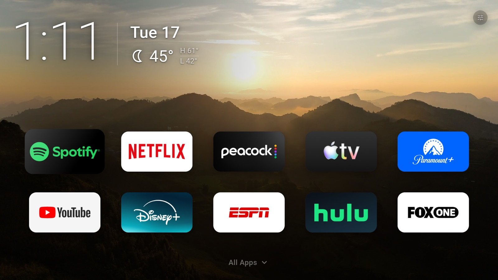

# TvOS

A calm, minimal home screen for Google TV and Android TV, made to feel like Apple TV's: your apps, the time and the weather, over a slow-moving background. No ads, no rows of recommendations, nothing you didn't put there.



## What's on the screen

- **Your ten apps** in two rows of five, in the order you choose. The focused app lifts and glows. There are no labels; the artwork is enough.
- **All Apps** sits below, behind a quiet "All Apps ⌄" hint: every app on the TV, alphabetical.
- **Time, date and weather** in the top-left corner: the current temperature with today's high and low.
- **A background** of your choice, picked from the small dot in the top-right corner:
  - **Gradient**: colors that follow the time of day, with a soft glow in the focused app's color behind it.
  - **Landscapes**: still photos that drift slowly, credited in the corner.
  - **Video loops**: calm footage of clouds, mist, mountains and desert, slowed to 0.4× so it looks like a picture that's barely moving. Each clip stays about 50 seconds, then dissolves into the next.

The TV's screensaver stays away while the home screen is showing (for up to two hours without a button press). Your background and app order are saved on the TV and survive power-offs and updates.

## Using it with the remote

| To | Do |
| --- | --- |
| Open an app | Select it and press **OK** |
| Rearrange the Home rows | Hold **OK** on an app, move it with the arrows, press **OK** to drop it (**Back** cancels) |
| Take an app off Home | Hold **OK** to pick it up, then hold **OK** again |
| Put an app on Home | In All Apps, hold **OK** on it |
| Reach All Apps | Press **Down** past the second row |
| Come back from All Apps | **Back**, or **Up** from the top row |
| Change the background | Select the dot in the top-right corner |
| Go back to what was playing or watching | Press **Up** from the top row to the card beside the clock, then **OK** |

### Adding new apps

Install apps the usual way, with **Google Play Store** (it's in All Apps). A new app shows up in All Apps by itself, in alphabetical order. Hold **OK** on it to put it on Home.

## Installing on a TV

TvOS is an ordinary app plus a small accessibility service that sends the remote's **Home** button to it. Google TV doesn't let you pick a different home screen, so the service is what makes it stick.

1. Build and sign a release APK (below), then install it over the network with `adb install`.
2. On the TV, open **Settings → System → Accessibility**, select **TvOS Home Button** under **Services**, turn on **Enable** and choose **Allow**.
3. Press **Home** from any app. You should land on TvOS.
4. Optional, for **Now playing** (the song, artist and cover beside the clock while music plays): give TvOS notification access, which is how Android lets an app see other apps' media sessions. Look under **Settings → Apps → Special app access → Notification access** and turn on **TvOS Notification Service**. If the TV doesn't show that page, grant it over adb instead:

   ```bash
   adb shell cmd notification allow_listener com.spencerking.tvos/com.leanbitlab.ltvL.LauncherNotificationListenerService
   ```
5. The first time Home opens it asks to read TV listings: allow it, and the card beside the clock can also show **Continue watching** (the show or film you were last part-way through, in apps that publish it).

After the TV restarts it briefly shows Google TV's own home first; the first press of **Home** brings TvOS back.

To undo it, turn the accessibility service off or uninstall TvOS. Nothing about the TV's own launcher is changed.

## Building

You need Flutter 3.24 and the Android SDK.

```bash
flutter build apk --release --target-platform android-arm
```

The APK lands in `build/app/outputs/flutter-apk/`. Release builds are signed with a key kept outside the repo, read from `~/.android/tvos-signing.properties`:

```properties
storeFile=/path/to/your-release.jks
storePassword=...
keyAlias=...
keyPassword=...
```

Keep that key safe: every update to an installed TvOS must be signed with the same one, or Android will make you uninstall it first (losing your app order).

The weather location is set in [`lib/widgets/home/top_info.dart`](lib/widgets/home/top_info.dart). Change the latitude and longitude to your own city.

Before merging a change, run the checks:

```bash
scripts/verify.sh
```

It generates the test mocks, then runs the analyzer and the full test suite.

## Privacy

TvOS talks to two services, and only for the background and the weather:

- **[Open-Meteo](https://open-meteo.com)**, for the weather, sent a city-level location every 30 minutes.
- **[Pexels](https://www.pexels.com)**, to download the video clips once; after that they play from the TV's storage.

There are no accounts, no analytics and no ads.

## Credits

TvOS is built on [LTvLauncher](https://github.com/leanbitlab-org/LtvLauncher) by LeanBitLab, itself a fork of [FLauncher](https://gitlab.com/flauncher/flauncher) by Étienne Fesser (via [osrosal's fork](https://github.com/osrosal/flauncher)).

Video clips are from [Pexels](https://www.pexels.com). Landscape photos are from Wikimedia Commons, credited in [`assets/landscapes/CREDITS.md`](assets/landscapes/CREDITS.md).

## License

GNU General Public License v3.0. See [LICENSE](LICENSE).
